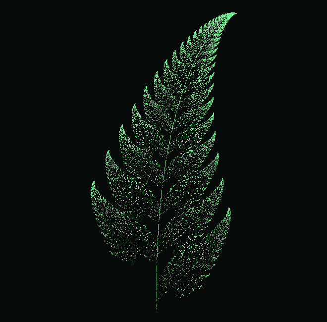
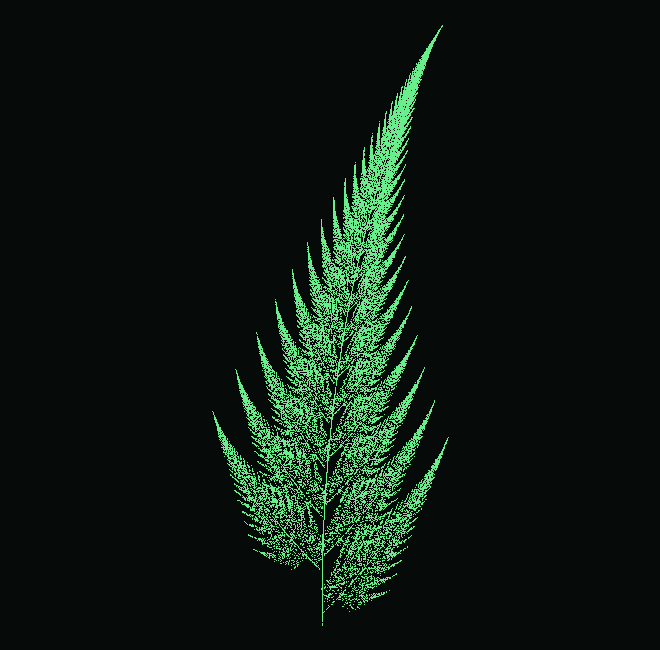

# Папоротник Барнсли

**Автор:** Шкарупин Сергей Иванович

**Группа:** ПИ25_2

**Дисциплина:** Практикум по программированию

**Дата сдачи:** 29.10.2026

## Описание

Программа рисует папоротник Барнсли из точек.
Форму растения можно менять ползунками или выбрать готовый вариант.

## Что умеет программа

### Основное

- Строит фрактал четырьмя преобразованиями.
- Позволяет менять коэффициенты и количество точек.

### Дополнительно

- Пять вариантов папоротника.
- Подбор масштаба под размер растения.
- Сброс к классическому виду и 20000 точек.

## Управление

| Элемент | Действие |
| --- | --- |
| Ползунки b, w, d | Меняют изгиб, ширину и вытянутость |
| Количество точек | От 2000 до 50000 точек |
| Готовые варианты | Выбор формы растения |
| Кнопка сброса | Возврат к начальным настройкам |

## Структура

```text
paporotnik/
├── paporotnik.py
├── README.md
├── requirements.txt
├── .gitignore
├── images/
└── venv/
```

Весь код в одном файле. Класс BarnsleyFern считает точки,
а FernApplication отвечает за окно. Для этой работы этого достаточно.

## Пример работы

Запустите программу, измените ширину ветвей, затем выберите
«Узкий папоротник». Кнопка сброса вернёт начальный вид.

## Как считается папоротник

Начальная точка — (0, 0). На каждом шаге случайно выбирается одно
из четырёх преобразований с вероятностями 1%, 85%, 7% и 7%.
Новые координаты добавляются на рисунок. Другие коэффициенты дают
другую форму растения.

## Примеры





Задание: «3.2 Сложная анимация», раздел «Папоротник Барнсли».
Основной пункт и изменение формы растения выполнены.
